## Stage 1: Transport Layer Processing

### **HTTP Transport Flow**

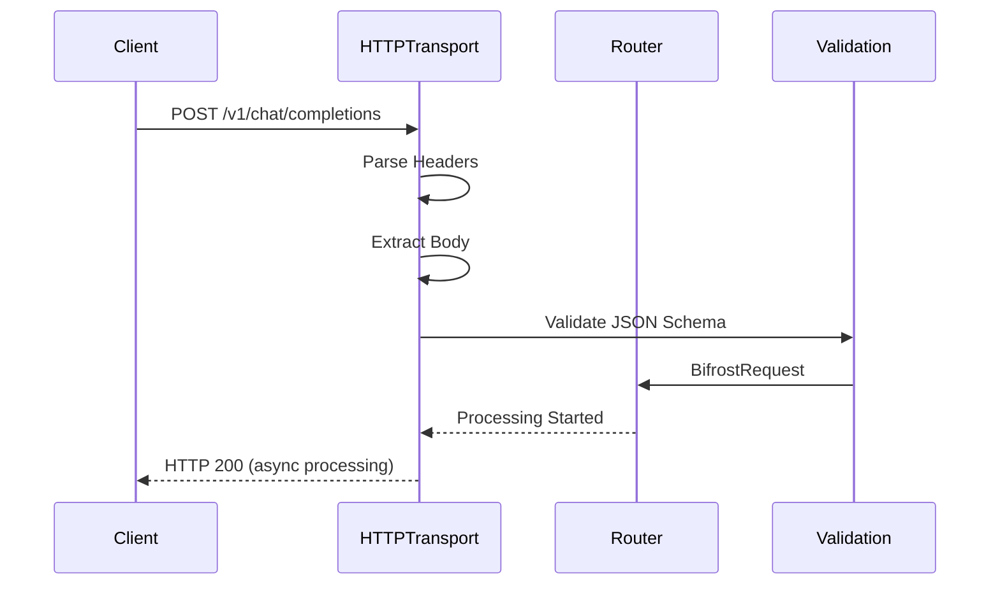

**Key Processing Steps:**

1. **Request Reception** - FastHTTP server receives request
2. **Header Processing** - Extract authentication, content-type, custom headers
3. **Body Parsing** - JSON unmarshaling with schema validation
4. **Request Transformation** - Convert to internal `BifrostRequest` schema
5. **Context Creation** - Build request context with metadata

**Performance Characteristics:**

- **Parsing Time:** ~2.1μs for typical requests
- **Validation Overhead:** ~400ns for schema checks
- **Memory Allocation:** Zero-copy where possible

### **Go SDK Flow**

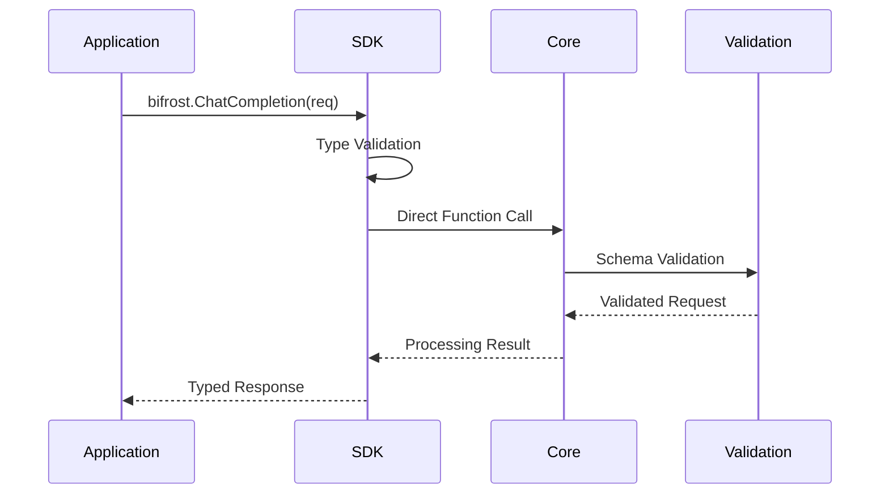

**Advantages:**

- **Zero Serialization** - Direct Go struct passing
- **Type Safety** - Compile-time validation
- **Lower Latency** - No HTTP/JSON overhead
- **Memory Efficiency** - No intermediate allocations

---

## Stage 2: Request Routing & Load Balancing

### **Provider Selection Logic**

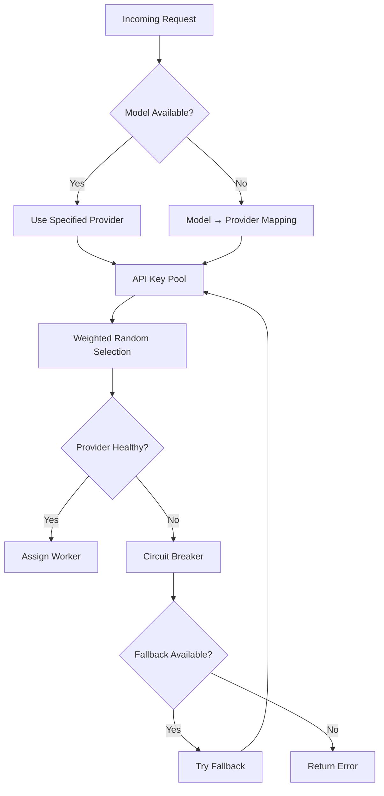

**Key Selection Algorithm:**

```go
// Weighted random key selection
type KeySelector struct {
    keys    []APIKey
    weights []float64
    total   float64
}

func (ks *KeySelector) SelectKey() *APIKey {
    r := rand.Float64() * ks.total
    cumulative := 0.0

    for i, weight := range ks.weights {
        cumulative += weight
        if r <= cumulative {
            return &ks.keys[i]
        }
    }
    return &ks.keys[len(ks.keys)-1]
}
```

**Performance Metrics:**

- **Key Selection Time:** ~10ns (constant time)
- **Health Check Overhead:** ~50ns (cached results)
- **Fallback Decision:** ~25ns (configuration lookup)

---

## Stage 3: Plugin Pipeline Processing

### **Pre-Processing Hooks**

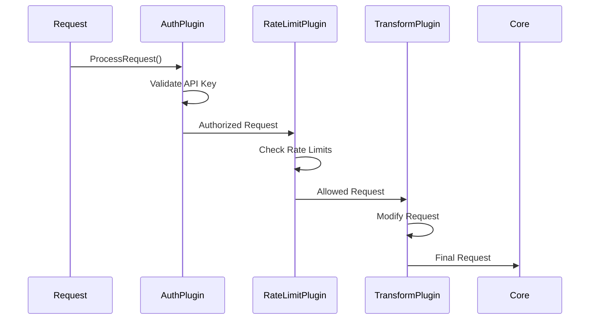

**Plugin Execution Model:**

```go
type PluginManager struct {
    plugins []Plugin
}

func (pm *PluginManager) ExecutePreHooks(
    ctx BifrostContext,
    req *BifrostRequest,
) (*BifrostRequest, *BifrostError) {
    for _, plugin := range pm.plugins {
        modifiedReq, err := plugin.ProcessRequest(ctx, req)
        if err != nil {
            return nil, err
        }
        req = modifiedReq
    }
    return req, nil
}
```

**Plugin Types & Performance:**

| Plugin Type           | Processing Time | Memory Impact | Failure Mode           |
| --------------------- | --------------- | ------------- | ---------------------- |
| **Authentication**    | ~1-5μs          | Minimal       | Reject request         |
| **Rate Limiting**     | ~500ns          | Cache-based   | Throttle/reject        |
| **Request Transform** | ~2-10μs         | Copy-on-write | Continue with original |
| **Monitoring**        | ~200ns          | Append-only   | Continue silently      |

---

## Stage 4: MCP Tool Discovery & Integration

### **Tool Discovery Process**

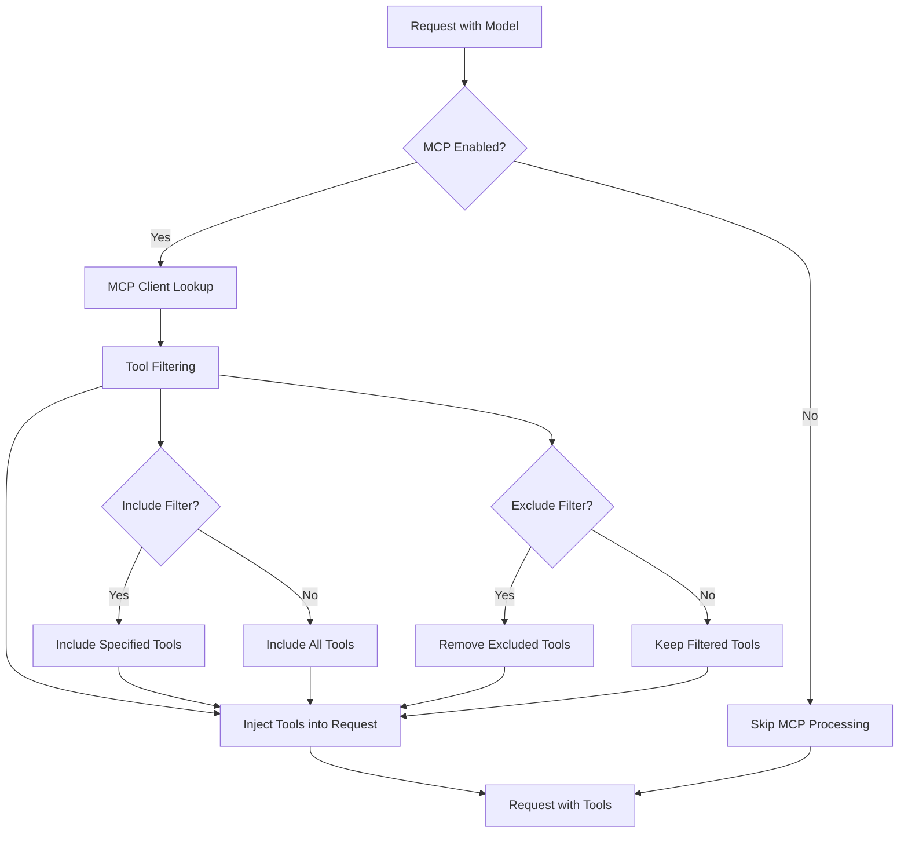

**Tool Integration Algorithm:**

```go
func (mcpm *MCPManager) EnhanceRequest(
    ctx BifrostContext,
    req *BifrostChatRequest,
) (*BifrostRequest, error) {
    // Extract tool filtering from context
    includeClients := ctx.GetStringSlice("mcp-include-clients")
    includeTools := ctx.GetStringSlice("mcp-include-tools")

    // Get available tools
    availableTools := mcpm.getAvailableTools(includeClients)

    // Filter tools  
    filteredTools := mcpm.filterTools(availableTools, includeTools)

    // Inject into request
    if req.Params == nil {
        req.Params = &ChatParameters{}
    }
    req.Params.Tools = append(req.Params.Tools, filteredTools...)

    return req, nil
}
```

**MCP Performance Impact:**

- **Tool Discovery:** ~100-500μs (cached after first request)
- **Tool Filtering:** ~50-200ns per tool
- **Request Enhancement:** ~1-5μs depending on tool count

---

## Stage 5: Memory Pool Management

### **Object Pool Lifecycle**

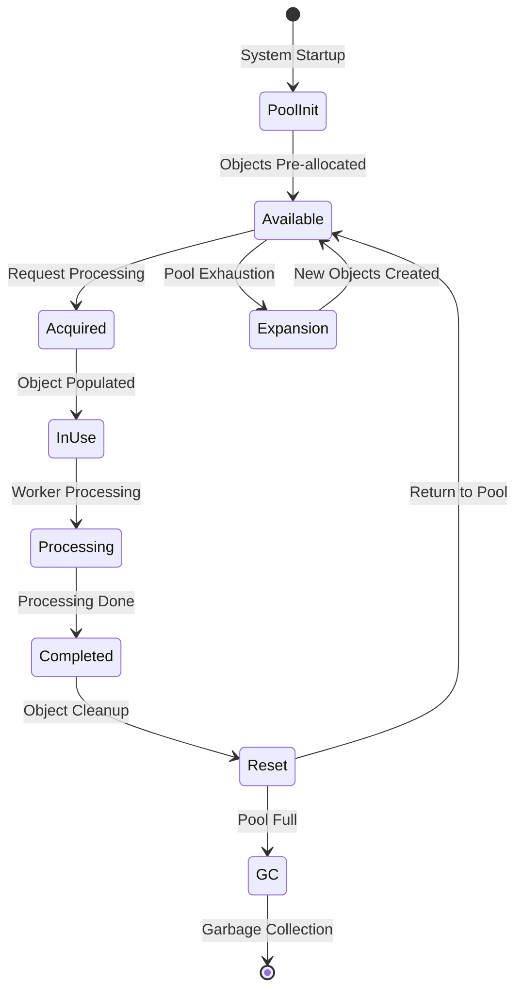

**Memory Pool Implementation:**

```go
type MemoryPools struct {
    channelPool  sync.Pool
    messagePool  sync.Pool
    responsePool sync.Pool
    bufferPool   sync.Pool
}

func (mp *MemoryPools) GetChannel() *ProcessingChannel {
    if ch := mp.channelPool.Get(); ch != nil {
        return ch.(*ProcessingChannel)
    }
    return NewProcessingChannel()
}

func (mp *MemoryPools) ReturnChannel(ch *ProcessingChannel) {
    ch.Reset() // Clear previous data
    mp.channelPool.Put(ch)
}
```

---

## Stage 6: Worker Pool Processing

### **Worker Assignment & Execution**

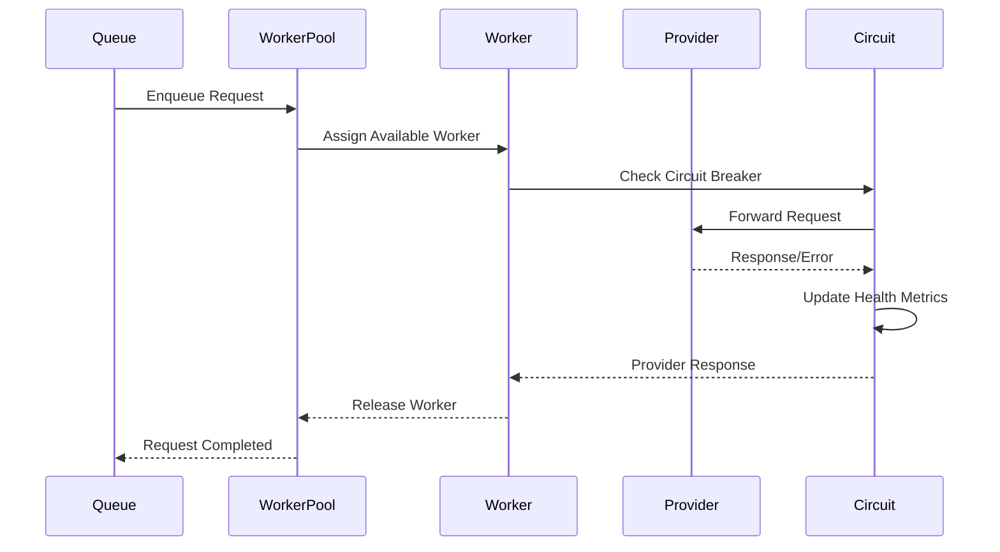

**Worker Pool Architecture:**

```go
type ProviderWorkerPool struct {
    workers    chan *Worker
    queue      chan *ProcessingJob
    config     WorkerPoolConfig
    metrics    *PoolMetrics
}

func (pwp *ProviderWorkerPool) ProcessRequest(job *ProcessingJob) {
    // Get worker from pool
    worker := <-pwp.workers

    go func() {
        defer func() {
            // Return worker to pool
            pwp.workers <- worker
        }()

        // Process request
        result := worker.Execute(job)
        job.ResultChan <- result
    }()
}
```

---

## Stage 7: Provider API Communication

### **HTTP Request Execution**

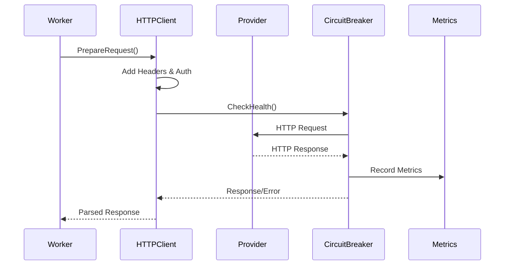

**Request Preparation Pipeline:**

```go
func (w *ProviderWorker) ExecuteRequest(job *ProcessingJob) *ProviderResponse {
    // Prepare HTTP request
    httpReq := w.prepareHTTPRequest(job.Request)

    // Add authentication
    w.addAuthentication(httpReq, job.APIKey)

    // Execute with timeout
    ctx, cancel := context.WithTimeout(context.Background(), job.Timeout)
    defer cancel()

    httpResp, err := w.httpClient.Do(httpReq.WithContext(ctx))
    if err != nil {
        return w.handleError(err, job)
    }

    // Parse response
    return w.parseResponse(httpResp, job)
}
```

### **Large payloads and conversion (fork)**

Two optimizations skip Bifrost's converters once a body crosses a size threshold. A large request is not parsed: the caller's bytes are streamed to the vendor as written. A large response is not parsed either: the vendor's bytes are streamed to the caller as written. Both are switched on by transport hooks (`LargePayloadHook`, and the response threshold on the request context). The hook types are defined in this repository, but no implementation is: the gateway this fork ships installs none, so every request is parsed and converted whatever its size. The rule below governs any hook that is installed later.

Skipping conversion is right only when the bytes are already in the shape the other side expects. One rule decides that for every provider attempt, `schemas.DecideLargePayloadEligibility` in `core/schemas/largepayload.go`. Core stamps its answer on the context before the provider is called, and the shared provider entry points (`CheckContextAndGetRequestBody`, `ApplyLargePayloadRequestBody`, `FinalizeResponseWithLargeDetection`, `SetupStreamingPassthrough`) read the stamp. With no stamp nothing is passed through raw.

| Case | Large request | Large response |
|------|---------------|----------------|
| Passthrough request (the provider forwards the caller's bytes by definition) | streamed raw | streamed raw |
| Native route whose wire format the provider takes unchanged: `openai` to OpenAI and Azure (not Claude), `anthropic` to Anthropic, `genai` to Gemini and Vertex (Google model families), `cohere` to Cohere, `typesafe` to Typesafe | streamed raw | streamed raw |
| Neutral `/v1` routes and Go SDK callers, any provider | refused with 413 before any upstream write | read in full and converted |
| Native route to any other provider, including every OpenAI-compatible provider and every custom provider | refused with 413 before any upstream write | read in full and converted |
| A plugin called `schemas.RequireBodyConversion` (a guardrail that rewrites bodies) | refused with 413 before any upstream write | read in full and converted |
| A fallback that serves another model than the staged body names | refused with 413 before any upstream write | as its row above |
| File content, container file content, video download (opaque content, nothing to convert) | as its row above | streamed raw |

The costs of the converting rows:

- **A large request that must be converted is refused**, with status 413, `error.code` `large_payload_not_convertible` and `error_type` `caller_invalid_request`. The body was never parsed, so there is no input to convert, and buffering it to parse it would hold the whole payload in memory, which is the cost the optimization exists to avoid. The caller sends the request below the threshold or through the provider's native route. A fallback is decided afresh: the staged body has not been read, so a fallback provider that takes it unchanged still receives it.
- **A large response that must be converted is held in memory once**, as it is with no threshold configured. Peak memory for such a response is the body size plus the converted response, per concurrent request. There is no upper bound on it, as there is none on any buffered provider response today: the threshold bounds memory only for the attempts that stream raw.
- **A staged body is never rewritten to another model.** It is forwarded unparsed, and the only change made to it is removing a provider prefix from its model. A fallback that serves a different model than the body names is therefore refused like a converting attempt: the key and governance checks admitted the fallback's model, and the vendor would otherwise be asked for the primary's. A fallback on the same model at a provider that takes the wire unchanged still receives the body whole.
- **A raw response carries no usage inside Bifrost.** The caller receives the vendor's body, usage included, but the response Bifrost's plugins see holds only metadata. Logging, cost and governance for a raw response depend on the response hook (`LargeResponseHook`) extracting usage from the stream.
- **On a native route a large body is forwarded as written.** Bifrost-only body fields and the adjustments Bifrost makes to a small raw body (stripping unsupported fields, for example) are not applied to it.

A new provider needs an entry in `largePayloadDeclarations` in the same file: the wire format its vendor takes unchanged, or the reason every request is converted. Without an entry it converts everything, and `TestLargePayloadDeclarationsCoverEveryProvider` fails until the entry exists.

---

## Stage 8: Tool Execution & Response Processing

### **MCP Tool Execution Flow**

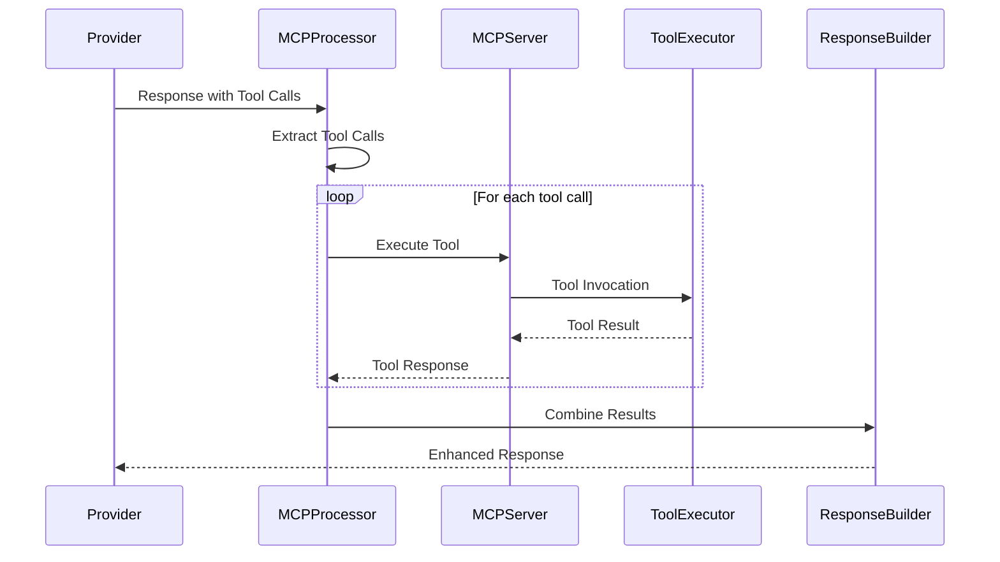

**Tool Execution Pipeline:**

```go
func (mcp *MCPProcessor) ProcessToolCalls(
    response *ProviderResponse,
) (*ProviderResponse, error) {
    toolCalls := mcp.extractToolCalls(response)
    if len(toolCalls) == 0 {
        return response, nil
    }

    // Execute tools concurrently
    results := make(chan ToolResult, len(toolCalls))
    for _, toolCall := range toolCalls {
        go func(tc ToolCall) {
            result := mcp.executeTool(tc)
            results <- result
        }(toolCall)
    }

    // Collect results
    toolResults := make([]ToolResult, 0, len(toolCalls))
    for i := 0; i < len(toolCalls); i++ {
        toolResults = append(toolResults, <-results)
    }

    // Enhance response
    return mcp.enhanceResponse(response, toolResults), nil
}
```

---

## Stage 9: Post-Processing & Response Formation

### **Plugin Post-Processing**

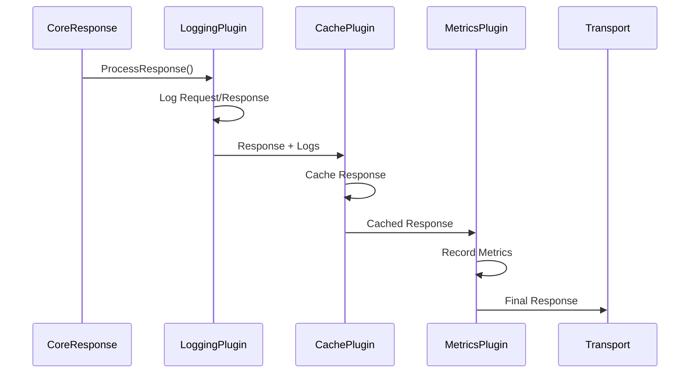

**Response Enhancement Pipeline:**

```go
func (pm *PluginManager) ExecutePostHooks(
    ctx BifrostContext,
    req *BifrostRequest,
    resp *BifrostResponse,
) (*BifrostResponse, error) {
    for _, plugin := range pm.plugins {
        enhancedResp, err := plugin.ProcessResponse(ctx, req, resp)
        if err != nil {
            // Log error but continue processing
            pm.logger.Warn("Plugin post-processing error", "plugin", plugin.Name(), "error", err)
            continue
        }
        resp = enhancedResp
    }
    return resp, nil
}
```

### **Response Serialization**

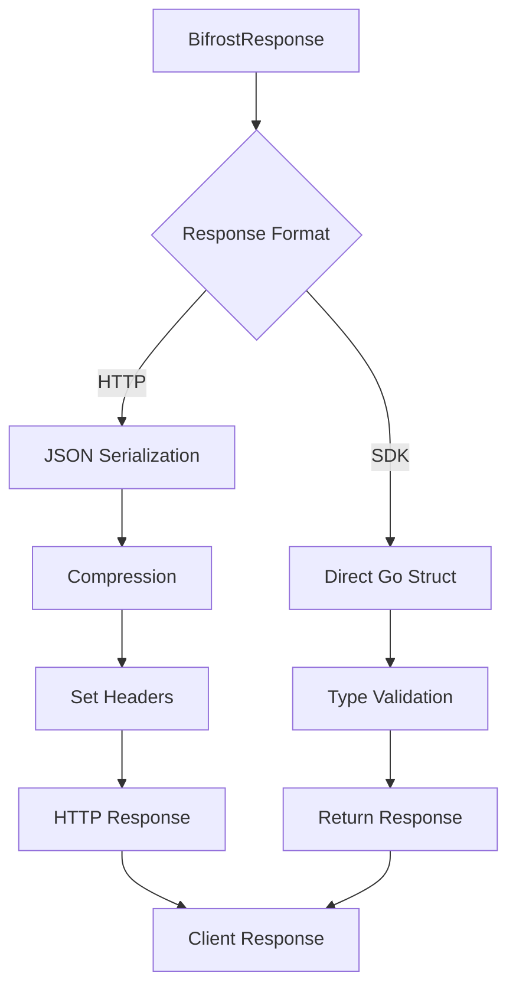

---

## Related Architecture Documentation

- **[Concurrency Model](./concurrency)** - Worker pools and threading details
- **[Plugin System](./plugins)** - Plugin execution and lifecycle
- **[MCP System](./mcp)** - Tool discovery and execution internals
- **[Benchmarks](../../benchmarking/getting-started)** - Detailed performance analysis
